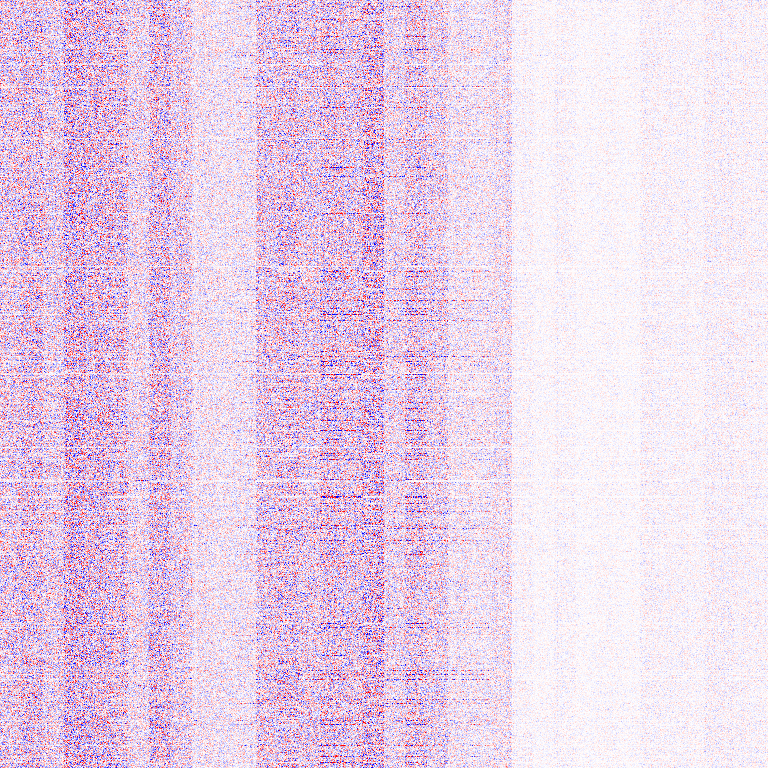

# png-weights

**A neural network, stored as a PNG.**

`pngweights` quantizes a Hugging Face language model and packs every weight into a single,
perfectly valid grayscale PNG. Open it in an image viewer and you get a very tall, very thin
picture of noise. Hand it back to `pngweights` and it turns into a working model again —
no original checkpoint needed, the architecture config travels inside the PNG.

```
$ pngweights pack openai-community/gpt2 gpt2.png --preset q4-rot
gpt2.png: 81.7 MB, 124.4M params, 5.25 bits/param, 31s

$ pngweights generate gpt2.png "The capital of France is"
The capital of France is a city of more than 100 million people, and it is home to ...
```

> 🇷🇺 Фан-проект: модель целиком лежит в обычном PNG. Внутри — групповое 4-битное квантование
> с подбором клиппинга, квантованными масштабами и (опционально) Hadamard-поворотом.
> Сжатие ~6× от fp32 при почти той же точности. Подробности и честные цифры — в [RESULTS.md](RESULTS.md).

It started as an accident: the plan was to *represent* a model as an image, and the result was
a model literally converted *into* an image. It turned out to work well enough to keep.

## What is actually inside

The PNG is just a container (8-bit gray, width 1024, zlib). The compression comes from the codecs:

| piece | what it does |
|---|---|
| **grouped 4-bit RTN** | every 32 weights share one scale; codes are 4-bit ints |
| **clip search** | per group, picks the clipping ratio with the lowest reconstruction error |
| **double-quant scales** | the scales themselves are stored as u8 (min/max per 16 groups) → 4.31 instead of 4.5 bits/weight |
| **Hadamard rotation** (`q4-rot`) | randomized block-Hadamard on the input dim spreads outliers before quantizing; helps dense models with outlier channels |
| **embeddings in 8-bit** | token embeddings / LM head are very sensitive; 4 bits destroys them |
| **tied weights stored once** | e.g. GPT-2 `lm_head` = `wte.T` |
| **byte-shuffled fp16** | everything small (norms, biases, routers) stays fp16, byte planes split so zlib can help |

The manifest (shapes, codecs, sha256 per tensor, model config) is embedded as a `zTXt` chunk.
Format details: [FORMAT.md](FORMAT.md).

## Install

```bash
pip install -e ".[hf]"          # numpy + torch + transformers
pip install -e ".[eval,dev]"    # + datasets, pytest
```

## Usage

```bash
pngweights pack MODEL out.png --preset q4      # q4 (default) | q4-rot | q4-fast | q3 | q8
pngweights info out.png                        # size breakdown per codec
pngweights verify out.png                      # decode everything, check all sha256
pngweights generate out.png "Once upon a time" -n 40
pngweights preview out.png weights.png --tensor transformer.h.0.attn.c_attn.weight
python examples/eval.py MODEL a.png b.png      # ppl / KL / top-1 vs the original model
```

`MODEL` is a hub id or a local directory. Which preset?

* **MoE models** → `q4`. Experts have no outliers, rotation does nothing for them.
* **dense models** → `q4-rot`. On GPT-2 it cut KL by ~20 % at the same size.
* `q3` is ~15 % smaller but clearly worse without calibration (see results).

From Python:

```python
from pngweights import hf
hf.pack("openai-community/gpt2", "gpt2.png", preset="q4-rot")
model = hf.load("gpt2.png", device="cuda")      # a regular transformers model
```

`preview` renders a weight matrix as an actual image (blue = negative, red = positive).
Here is GPT-2's first attention projection — you can see the Q / K / V blocks and per-head structure:



## Results (short)

Full tables, including what did *not* work: [RESULTS.md](RESULTS.md).

| model | fp32 | PNG | KL vs fp32 | top-1 agreement |
|---|---|---|---|---|
| TinyMoE-200M (16 experts) | 799 MB | **~120 MB** (`q4`) | 0.022 | 90.1 % |
| GPT-2 small (dense) | 498 MB | **~82 MB** (`q4-rot`) | 0.110 | 81.1 % |

MoE experts compress *much* better than dense layers: same bits, ~5× lower KL.

## Limitations

* Weights are decoded to fp32 on load: the PNG saves **disk**, not RAM/VRAM.
* No calibration (GPTQ/AWQ): 3-bit loses noticeable quality.
* Conceptually this is close to GGUF `Q4_K` — the PNG part is for fun, the codecs are standard tricks.

## Tests

```bash
pytest -q          # codec tests are numpy-only; HF tests use tiny random GPT-2 / Qwen3-MoE models
```

## License

MIT
